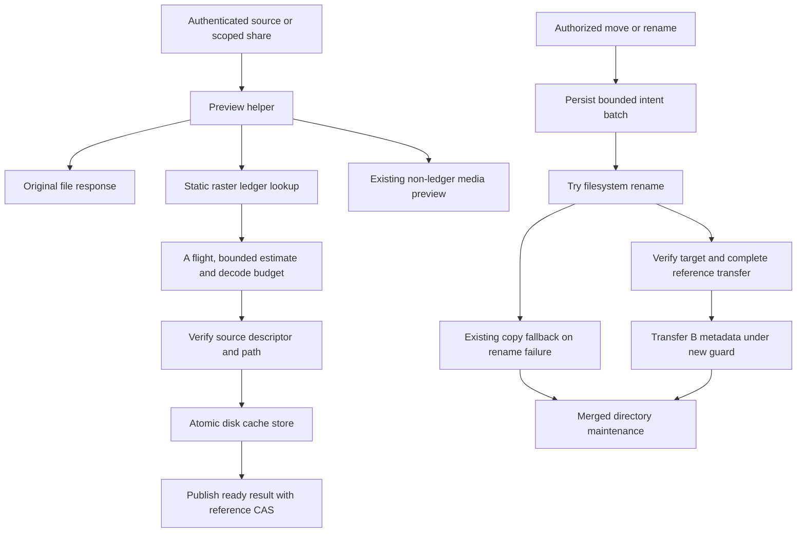

# 007-C cache ledger and move reuse

The product base is `a10edcb`. Development starts at the task handoff
`0127b62` on `feature/007c-cache-move-reuse`. The local candidate retains
the migrated A preview admission and B image metadata code.

## Identity and storage

The ledger is a separate SQLite file under the configured cache directory.
The existing index can be recreated and runs with synchronous OFF. Ledger
intents use WAL and synchronous FULL. The schema transaction identifies version
1. A file created by C starts with mode 0600. The SQLite driver and cache
directory setting are shared with the existing app.

| Table | Identity | Data |
| --- | --- | --- |
| `refs` | `(source,path)` using a filesystem and parent directory locator plus normalized leaf name | Exact observed version and current asset |
| `assets` | Random ID | One content generation, retained across a proven rename |
| `results` | `(asset,variant)` | Ready physical key, byte count, SHA-256, generated time and foreground use time |
| `moves` | Intent ID, indexed by state and ID | Expected source and target references and terminal state |

The location check starts with an authorized source root and canonical parent.
It binds the leaf using filesystem identity, parent dev and parent inode.
Nested descendants retain their parent locator through a same-filesystem
ancestor rename. Old path recreation produces a different locator or a
different leaf version. There is no alias chain or subtree to materialize for
preview references. The leaf version includes logical size, mtime, ctime,
device and inode. A missing stat, filesystem identity failure or weak platform
cannot authorize a persistent hit. A change assigns a new random generation.

The variant identifies the raster algorithm revision, MIME and effective
encoding, width, height, resize mode, quality and JPEG fallback setting.
Small is 256×256 fill, large is 640×640 fit, and xlarge is 1024×1024 fit.
Orientation, filters and fallback behavior are part of the revision. JPEG and
PNG, BMP, TIFF and supported PNM extensions use the ledger. Animated formats,
RAW and HEIC embedded previews, documents, audio art and video keep their
existing compatibility paths. The video seek parameter has no effect on
static raster generation.

## Lookup and publication

The HTTP permission and source/scope checks finish before lookup. The ledger
matches the reference generation and version, bounds the physical read by
recorded size, compares the stored digest, and reobserves the source before
returning bytes. A corrupt or absent result rejects only the observed ready
record. An atomic replacement published concurrently keeps its own record.
The key points to the existing disk cache. Ledger bytes are never deleted by
`DelThumbs`. Original direct responses create no ready entry.

A miss uses the existing A flight, estimate, admission and source descriptor.
A durable lookup uses the asset and variant as the task key. When the ledger
is unavailable or the observation is weak, the task key uses the clean path,
available stat fields and variant. It exists only while a task is in flight.
Requests for that key share the task within the existing slot and waiter
limits. Weak observations never publish or load persistent raster cache
entries. Each weak waiter checks that its observed file still matches both
the worker's descriptor and the current path. A replacement that reused the
same size and mtime can therefore fail with source-changed and be retried.
A weak platform cannot prove an in-place edit that preserves every available
observation.

The initial version must match the admitted descriptor. The before/after
check includes ctime on strong platforms. Store precedes a publication CAS
against the reference and version. A move or replacement can supersede that
reference. A concurrent move may cause a source-changed response.

The shared worker carries the identity of a verified hit or a successful
publication to each waiter. Only a successful foreground retrieval records
use, with a separate CAS against both the active reference and the observed
ready record. An abandoned decode can still finish and publish an unused
result. Directory candidate probes, preheats, repository publication and
recovery leave the foreground usage time alone. A recent hit skips the usage
write altogether. The SQL cutoff coalesces racing updates to one mutation per
minute per result. The ledger hashes generated thumbnail bytes for integrity.
The move path does not read or hash originals.

## Move and B metadata

The resource handler keeps permission checks and groups independent file moves
up to 64. It flushes potential dependencies, directory operations, and
automatic suffix choices in request order. The physical adapter acquires the
location gate with a deadline, observes existing strong reference versions,
and commits the intent batch. It tries `os.Rename` explicitly. A successful
call plus matching source and target identity/size/mtime and a missing old
path permits a target ctime rebind. Target reference CAS includes both its
asset and prior version. Success updates the reference and marks the intent
done in one transaction.

If rename fails, the adapter releases the location gate before the existing
copy path and its asynchronous source deletion. The copy cannot transfer a
generation. Ambiguous outcomes leave existing references gated by full
version. A ledger error is logged independently from the physical result. No
SQL transaction holds across file copy, decode, or directory refresh.

The single-file B transfer reads a ready row with the exact source version
and installs the target's actual version and a fresh guard. An overwrite
with no valid source metadata clears the older target ratio under a newer
observation. Old B completions remain UPDATE-only and include version/guard.
The existing background maintenance queue moves ready directory metadata in
64-row keyset pages before removing old index rows. Each descendant must match
its full unchanged B version at the target. Its directory write guard protects
against a later application move. A browse before this optional transfer can
show an unknown ratio. B's normal parser/backfill handles edits, interrupted
jobs and directory chains that supersede a target before the transfer runs.

## Recovery and compatibility

At start the preview owner captures a journal high water mark. One cancellable
worker processes 64 pending entries per page. Each page invalidates only
matching primary-key rows. Runtime completion failures wake the same worker
through a one-slot signal. It captures a fresh high water mark after the
active group leaves the location gate. Recovery waits between pages and backs
off from milliseconds up to five seconds on database errors. Done and
ambiguous entries are terminal. Untouched old intents may cause an initial
miss, and a rename without a completed transaction may also miss. The worker
does not change real files, rewrite later generations, or infer a successful
syscall from inode alone. The filesystem and SQLite commits are separate
durability domains.

HTTP handlers drain before the existing preview shutdown in `cmd/root.go`.
Preview shutdown cancels and waits for flights and the ledger worker before
closing the ledger. The recovery worker uses only its own database. Existing
index maintenance drains before the index database closes. B transfer
happens in an HTTP operation or that maintenance worker.

An A/B cache key cannot prove the complete file version, even when a ready B
index row exists. An unregistered legacy file remains on disk and can be
rebuilt on first C access. A physical old key can be reused with independent
C publication evidence for the active version and exact digest. The migration
does not bulk adopt old entries. An A/B writer leaves the ledger alone. On
return to C, both the current file version and stored result digest still
gate reads. Explicit configured cache-directory cleanup continues to apply.

Stat evidence cannot distinguish every external write that coincides with
rename and restores mtime. The normal reuse contract covers controlled same
disk renames. Copies, external moves, weak observations, post-crash ambiguity
and missing cache entries can miss. The schema retains physical results and
terminal move records for future cache maintenance work.
